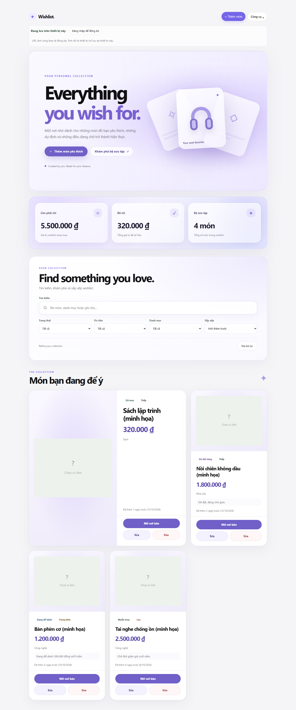
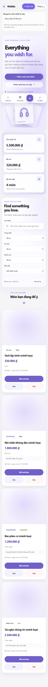

# Dream Vault V5 — Design Foundation (Bài 15A)

Status: specification only — no production code changed in this document.
Branch: `feature/dreamscape-v5` (from V4 freeze `ui-v4.0.0`).
Direction: Light Lavender + Soft Glass + Floating Objects. No full dark theme.

## 1. Palette (Dreamscape 3D)

| Token | Value | Role |
|-------|-------|------|
| `--dream-bg` | `#F8F6FF` | Page background |
| `--dream-surface` | `#FFFFFF` | Content cards |
| `--dream-mist` | `#DED5FF` | Light layers |
| `--dream-accent` | `#6850BC` | Primary CTA |
| `--dream-highlight` | `#A88BF7` | 3D objects, decoration |
| `--dream-ink` | `#19152C` | Headings, body |
| `--dream-radius-lg` | `28px` | Product card |
| `--dream-radius-xl` | `36px` | Hero, dashboard |

## 2. Typography

System stack (no webfont download required). Headings weight 650–800
with negative tracking; body inherits current scale. No Google Fonts.

## 3. Desktop wireframe — 1440px

- Content max-width 1280px, side margins 32–48px.
- Hero ~52/48 split, height 600–660px: editorial headline left,
  floating 3D stage right (reuse `.hero-scene`, no Three.js).
- Dashboard: 3 glass panels below hero, same light language.
- Collection keeps search/filter IDs; gallery keeps featured 2-col span.

## 4. Mobile wireframe — 375px

- 16px margins, vertical hero (text first, calmer 3D), no scroll parallax.
- CTA min-height 48px; bottom dock keeps navigation + keyboard focus.
- Decorative 3D reduced, never covering Search; Collection reachable
  without excessive scrolling.

## 5. Motion principles

| Level | Effect | Rule |
|-------|--------|------|
| Ambient | Hero light drift, very subtle | Desktop only, never distracting |
| Interaction | CTA, card, focus, hover | 160–280 ms |
| Celebration | Purchased state | Reuse existing Purchased Motion |

`prefers-reduced-motion: reduce` disables all decorative motion while
keeping state and content perceivable.

## 6. Immutable DOM IDs and handlers (V5 must not break)

`grid`, `q`, `fStatus`, `fPriority`, `fCategoryFilter`, `fSort`,
`btnClearFilter`, `sumTotal`, `sumSpent`, `sumCount`, `btnAdd`,
`heroAddWish`, `mobileAddWish`, `mobileSearchJump`, `emptyAction`,
`dlg`, `form`, `dlgTitle`, `fId`, `fName`, `fPrice`, `fCategory`,
`fStatus2`, `fPriority2`, `fLink`, `fImageUrl`, `fFile`, `fileErr`,
`fPreview`, `btnClearImg`, `fNote`, `btnCancel`, `syncStatus`,
`btnSignIn`, `btnSignOut`, `syncError`, `importFile`.
Handlers: `card(it)`, `render()`, `save()`, `cycleStatus()`,
`openForm()`, tilt/entrance/celebration lifecycle, Firebase Auth/Sync,
localStorage persistence, Import/Export.

## 7. Constraints

- Budget $0: no paid APIs, no runtime AI images, no Three.js, no new
  animation libraries.
- No changes to Firebase Auth, Cloud Sync, persistence, CRUD logic,
  or validation in the design phase.
- V5 CSS must use shared tokens + scoped selectors (`.hero--v5`,
  `.dashboard-panel--v5`), never casual global overrides — the V2→V5
  layer stack is already deep.

## 8. Reference screenshots (V4 current state)

| Viewport | Reference |
|----------|-----------|
| 1440 |  |
| 375 |  |

Captured headless Chrome 155 at `ui-v4.0.0` state, 0 overflow, 0 JS
errors. V5 work is measured against these.

## 9. Gate checklist (8/8 for 15A)

- [x] Branch `feature/dreamscape-v5` from V4, pushed with upstream
- [x] Design spec desktop/mobile saved (this file)
- [x] Palette and foundation tokens chosen (§1)
- [x] 3D depth and motion levels chosen (§5)
- [x] Immutable IDs/handlers listed (§6)
- [x] $0 limits + no-Firebase rule recorded (§7)
- [x] Reference screenshots 1440 + 375 saved (§8)
- [x] Spec review before 15B code — pending mentor review
