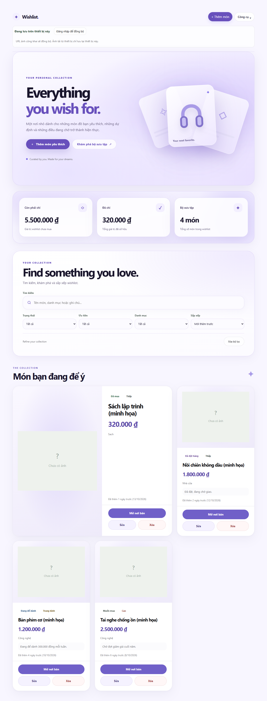
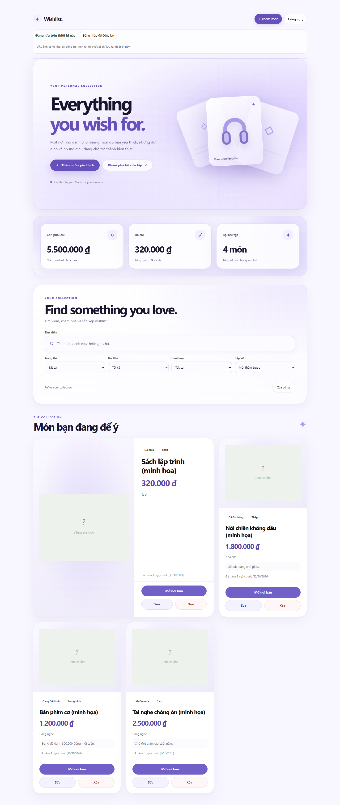
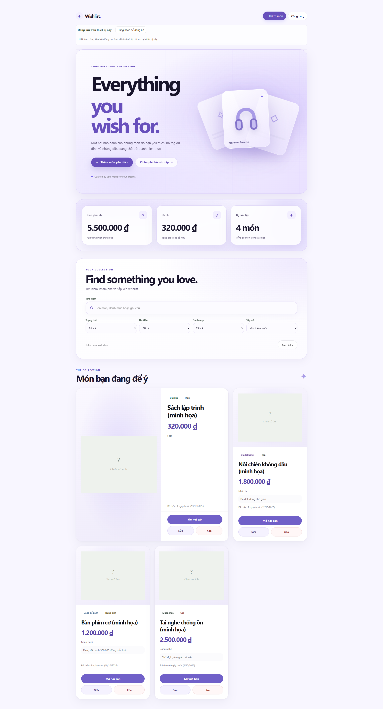

# Dream Vault V6 — Desktop Art Direction (Bài 16A)

Status: specification only — no production code changed.
Branch: `feature/desktop-showroom-v6` (from tag `ui-v5.0.0`).
Priority: Desktop 1440–1920px first, laptop 1280px second, tablet/mobile later.
Mobile V5 stays untouched until desktop V6 is accepted.

## 1. Problem (from V5 baseline screenshots)

At 1920px the content column stays ~1200px centered with large empty
margins; hero, dashboard and gallery do not use the extra space.
Featured card keeps the same 2-of-3 rhythm at every desktop width.
V6 must make a 1440–1920px screen feel like a showroom, not a centered
column with margins.

Baseline references (V5 frozen state, 0 overflow, 0 JS errors):

| Viewport | Reference |
|----------|-----------|
| 1280 |  |
| 1440 |  |
| 1920 |  |

Current V5 facts: 3-col grid with featured `span 2` at all desktop
widths; hero 640px tall (723px at 1920 via vw padding); no overflow
at 1280/1440/1920.

## 2. Desktop layout targets

| Area | 1280px | 1440px | 1920px |
|------|--------|--------|--------|
| Content max-width | 1200px | 1280px | 1440px |
| Side margins | 32px | 48px | fluid, ≥64px |
| Hero | 52/48 split, 600px | 52/48 split, 620–660px | wider stage, same split |
| Gallery | 3 cols, featured span 2 | 3 cols, featured span 2 | 3 cols, featured span 2, larger gaps |
| Dashboard | 3 glass cards | 3 glass cards | 3 glass cards, more air |

## 3. Visual system (kept from V5)

Light Lavender + Soft Glass + Floating Objects. No dark theme.
Dreamscape tokens (`--dream-*`) remain the source of truth; V6 adds
desktop-only composition rules, never global overrides.

## 4. Spacing & typography rules

- Section rhythm: 32px gaps desktop, generous panel padding; no new
  fonts (system stack, headings 650–800, negative tracking).
- Product imagery: keep `contain` staging from V4; larger frames on
  wide screens, never distorted.
- Motion: hover + tilt only; no continuous ambient animation across
  many cards; `prefers-reduced-motion` disables decoration.

## 5. Components to upgrade (16B–16D)

Header, Hero 3D composition, Dashboard rhythm, Collection workspace,
featured Gallery exhibition. Mobile V5 frozen until desktop accepted.

## 6. Invariants (never break)

Hero CTAs (`heroAddWish`, secondary anchor), Search/Filter IDs (`q`,
`fStatus`, `fPriority`, `fCategoryFilter`, `fSort`, `btnClearFilter`),
stats IDs (`sumTotal`, `sumSpent`, `sumCount`), CRUD handlers,
`card(it)`, `render()`, `save()`, tilt/entrance/celebration lifecycle,
Firebase Auth/Sync, localStorage, Import/Export. No paid APIs,
no Three.js, no new animation libraries, $0 budget.

## 7. Gate checklist (16A)

- [x] Branch `feature/desktop-showroom-v6` from `ui-v5.0.0`, pushed
- [x] Layout targets 1280/1440/1920 defined (§2)
- [x] Colors/spacing/components direction set (§3–§5)
- [x] Baseline screenshots saved (§1)
- [x] Invariants listed (§6)
- [x] No production CSS/JS changed in this step
- [ ] Spec review before 16B code — pending mentor review
