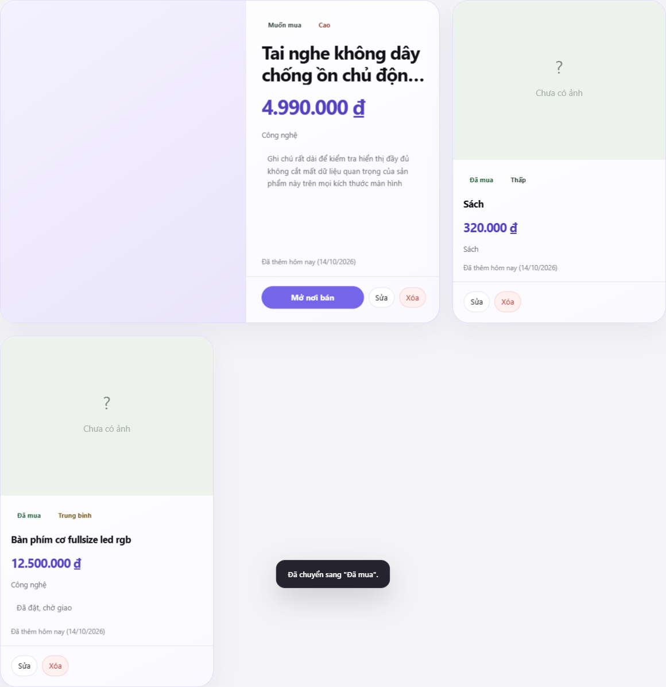
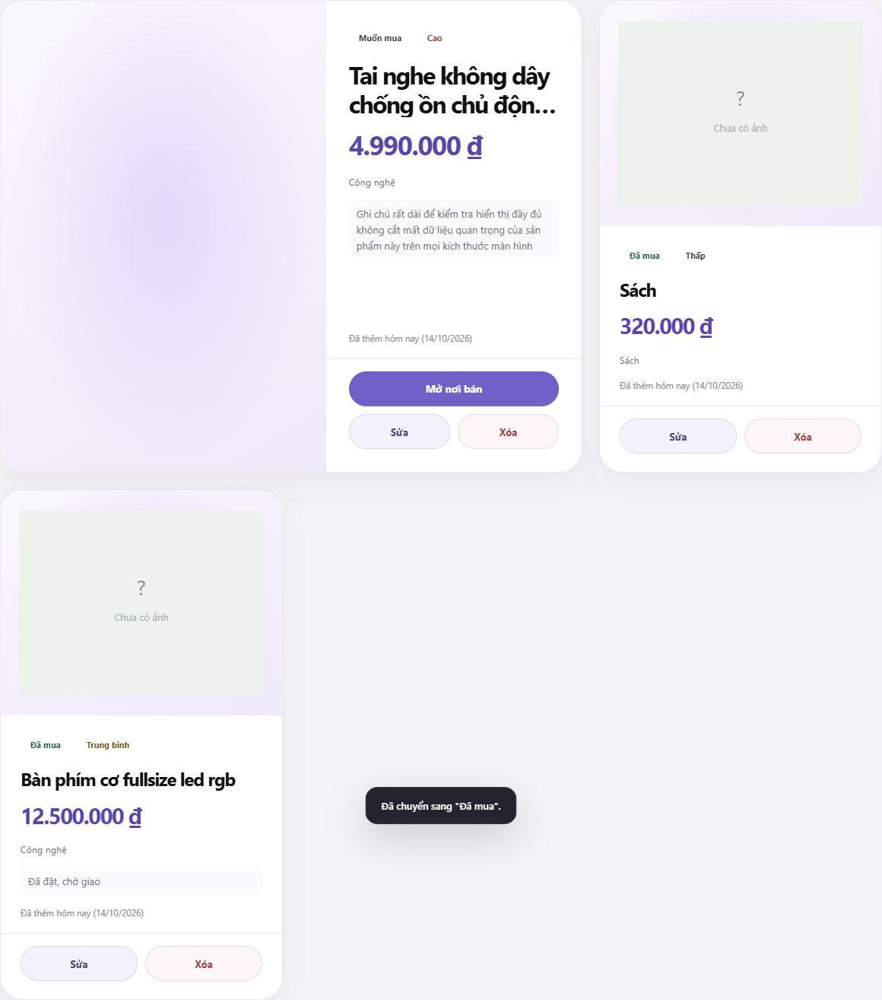
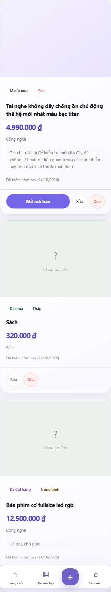
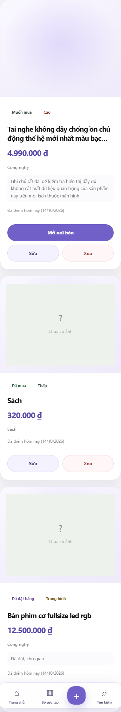

# Dream Vault V4 — Visual QA (Bài 14D)

Date: 2026-10-14. Branch: `feature/apple-minimal-3d`.
V3 baseline: tag `ui-v3.0.0` (`863dec8`). V4 under test: `ed15526`.
Method: headless Chrome 155, fresh browser context per case, identical
seeded dataset (real image + no-image + no-link + long name/note +
purchased), no cloud sync. Tilt smoke via synthetic `pointermove`
(CDP mouse does not reliably fire pointer events in this harness —
harness quirk, identical on both versions).

## Screenshots (same dataset both versions)

| Viewport | V3 | V4 |
|----------|----|----|
| 1440 gallery |  |  |
| 375 gallery |  |  |

Visible V4 differences: larger editorial titles, purple prices,
spacious white surfaces, full-width action rows, contained image
showcase. No clipped buttons or overflowing text on either version.

## Gate results (14/14)

| # | Check | Result |
|---|-------|--------|
| 1 | V3 vs V4 @1440 same dataset | PASS — layout matrix identical (3 cols, featured `span 2`), visuals differ as designed |
| 2 | V3 vs V4 @375 same dataset | PASS — 1 col both, no overflow either version |
| 3 | Layout 320/430/768 | PASS — 1/1/2 cols, featured `auto`, no overflow |
| 4 | Card with and without image | PASS — real image contained, placeholder correct |
| 5 | Card with and without purchase link | PASS — buy full-width vs Sửa/Xóa split |
| 6 | Long product name and note | PASS — wraps fully, 105-char note intact, prices fit |
| 7 | Featured card desktop | PASS — `span 2`, image-left composition, actions visible |
| 8 | Purchased state | PASS — `is-purchased` renders, chip click advances to `Đã mua` + toast |
| 9 | Tilt desktop / Reduced Motion | PASS — synthetic tilt rotates (rx 2.98°/ry 4.87°) and resets; `reduce` disables motion, 0 running animations |
| 10 | Sửa/Xóa/Mở nơi bán buttons | PASS — all measurable, clickable sizes (46 desktop / 48 mobile) |
| 11 | Mobile dock clears last card | PASS at 320/375/430 |
| 12 | No overflow / new console errors | PASS — 0 errors across all 8 cases |
| 13 | Screenshots + results in repo | PASS — this file + `docs/images/v4-qa/` |
| 14 | No Firebase/storage/sync changes | PASS — 14C touched `wishlist.html` + `mobile-products-v4.css` only |

## Notes / limits

- Tilt verified via synthetic events, not CDP mouse hover (harness quirk).
- Celebration verified through status-chip flow to `Đã mua` + toast;
  the transient glow class already passed in 05C/11C interaction tests.
- Real-device keyboard behavior (Bài 13D concern) still needs hardware
  confirmation; headless cannot open a virtual keyboard.
- No `ui-v4.0.0` tag created — freeze decision pending review.
