# Dream Vault V7 — 17E Desktop Visual Review & Freeze Gate

| Hạng mục | Giá trị |
| --- | --- |
| Task | 17E — Cinematic Visual Overhaul + Desktop QA/Freeze Gate |
| Branch | `feature/cinematic-motion-v7` |
| Baseline | `ui-v6.0.0` → tiếp nối `be0f21b` (17D) |
| Code commit | `acd9c7a` — *feat(ui): apply V7 cinematic visual overhaul (desktop)* |
| Budget | $0 — không thư viện, không dịch vụ trả phí |
| QA | **78/78 PASS** (headless Chrome + Puppeteer, 1280/1440/1920 + 1024/768/375) |

## 1. Art direction — Light Lavender × Premium Editorial

Nguyên tắc: V7 phải **khác V6 ngay cái nhìn đầu tiên**, ưu tiên art direction, motion chỉ hỗ trợ.
Toàn bộ override nằm trong `css/cinematic-v7-visual-overhaul.css` (import sau `cinematic-v7-workspace.css`),
giới hạn `@media (min-width: 1025px)`, scoped `body.dreamscape-v5`. Không sửa file CSS cũ, không sửa DOM
chức năng, không sửa ID, không sửa Firebase/CRUD/Auth.

Kỹ thuật chữ chính: tiêu đề Heavy Sans + dòng chữ ký **Georgia italic serif** (font hệ thống, $0) —
tạo tương phản editorial rõ rệt so với V6 (100% sans).

## 2. Thay đổi theo Workstream

### A. Signature Hero
- Hero canvas: 4 lớp gradient (violet ellipse 78%/36%, mist 14%/94%, ánh sáng trắng, nền 132°), viền
  trắng trong, bo góc 46px, đổ bóng sâu — chiều sâu điện ảnh so với nền phẳng V6.
- Typography: eyebrow ✦ + hairline rule; tiêu đề `clamp(4rem→6.8rem)`; dòng "*you wish for.*" chuyển sang
  Georgia italic serif accent; mô tả có hairline trái; footer uppercase tracked.
- Sân khấu: halo radial + vòng orbit dashed (pseudo-element, tĩnh) quanh scene; scene container
  `scale(1.08)` (**chỉ scale container — transform chain 3 card giữ nguyên tuyệt đối**); front card
  252×324 (V6: 230×290) với viền inset violet; glow sâu hơn; back/middle card opacity .70/.80 tạo chiều sâu.
- Watermark "07" serif italic góc phải dưới (pseudo, `z-index:-1`).
- Đã sửa trong QA: card giữa tràn 16–20px ra ngoài hero panel ở 1280/1440 → hạ scale 1.12→1.08 +
  `right: -4%→-1%` (positioning, không phải transform). Sau sửa: mid.r 1232 ≤ hero.r 1240 @1280.

### B. Premium Collection Workspace
- Dashboard: panel glass sâu hơn; grid `1.45fr 1fr 1fr` — **stat đầu tiên là card violet gradient nổi bật**
  (value trắng `clamp(2.5→3.8rem)`, icon glass, watermark "01" serif) — không còn ba card giống hệt nhau.
  Hai stat còn lại trắng, nhãn uppercase tracked, watermark 02/03.
- Collection: heading "Find something you love." chuyển Georgia italic lớn; bảng điều khiển tách bằng
  hairline dọc; **Search chủ đạo** — input 74px, bo 24px, shadow nâng; nhãn micro uppercase;
  select pills mềm 16px; footer hint italic; nút Xóa bộ lọc pill outline accent.

### C. Exhibition Gallery
- List heading: eyebrow ✦ tracked, tiêu đề "Món bạn đang để ý" Georgia italic, decoration ✧ lớn.
- Featured: min-height 560px, tỉ lệ media/content 1.24/.76 (đo thực tế 1.63), media là sân khấu triển lãm
  (gradient violet đa lớp + floor vignette + **plaque "01 / THE FEATURED DREAM"** + drop-shadow tĩnh cho ảnh);
  content cỡ lớn (title ≤2.3rem, price ≤2.2rem), cat/meta uppercase tracked, nút pill.
- Regular cards: gọn lại (media 16/10, padding hẹp, chữ nhỏ hơn, shadow giấy lavender) để featured thật sự nổi bật.
- Card purchased vẫn giữ viền xanh `#d5eadd` + media xanh (re-assert sau rule V7).

### D. Motion Performance
- 4 animation hero 17B giữ nguyên, thêm **visibility-based pause**: script inline presentation-only
  (IntersectionObserver trên `.hero--v7` + `visibilitychange`) toggle class `hero--v7-paused` →
  `animation-play-state: paused`. Không animation/JS mới, không đụng logic app.
- Xác minh: hero visible → 4 running; offscreen → 4 paused / 0 đang chạy; về đầu trang → resume;
  tab ẩn → paused; tab hiện → resume. Reduce-motion → animations none (17B `!important`).

## 3. Bằng chứng hình ảnh (before = `be0f21b`, after = `acd9c7a`, cùng dataset)

### Full-page 1280 / 1440 / 1920
| Before | After |
| --- | --- |
| 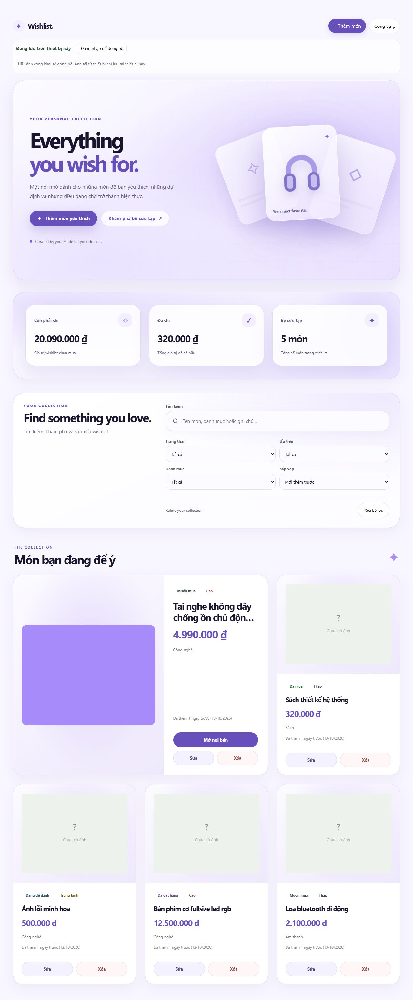 | 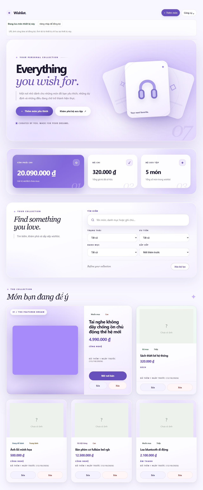 |
| 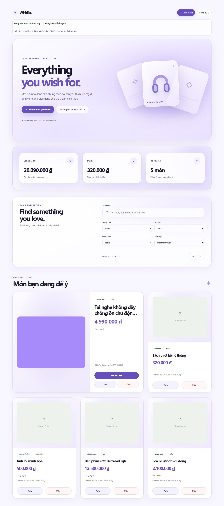 | 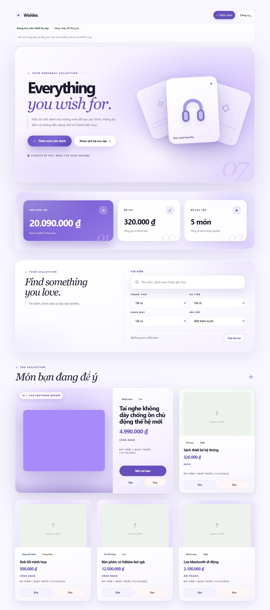 |
| 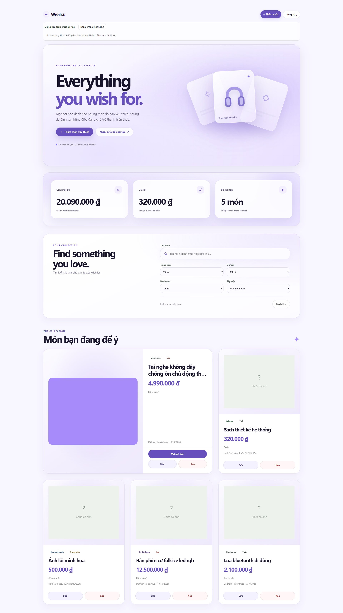 | 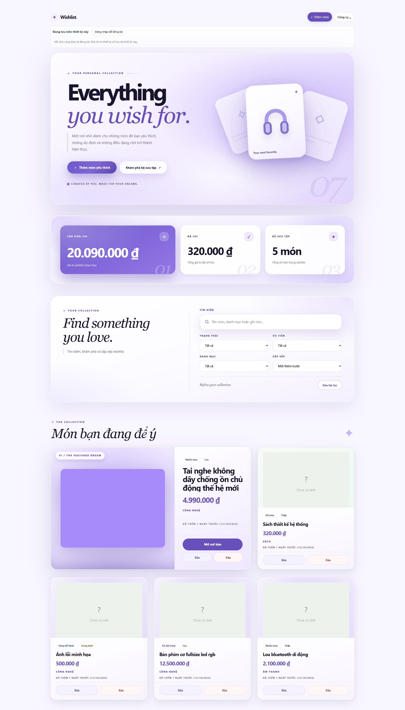 |

### Chi tiết từng khối @1440
| Khối | Before | After |
| --- | --- | --- |
| Hero | 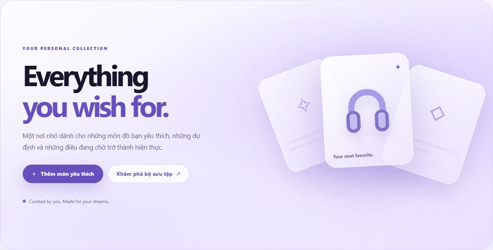 | 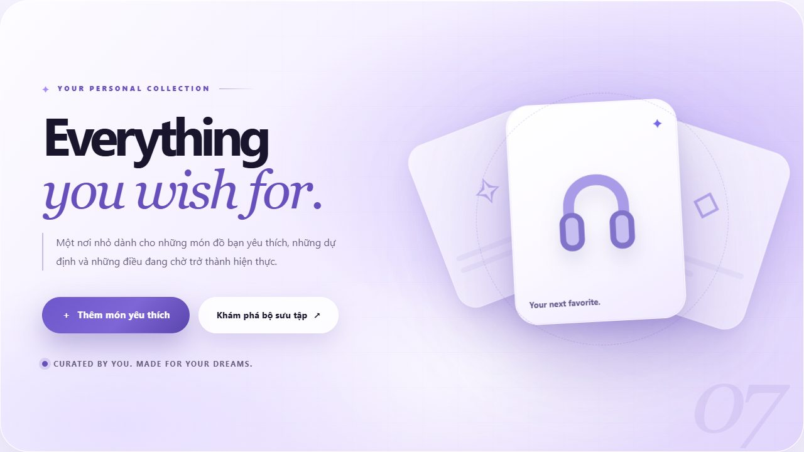 |
| Dashboard | 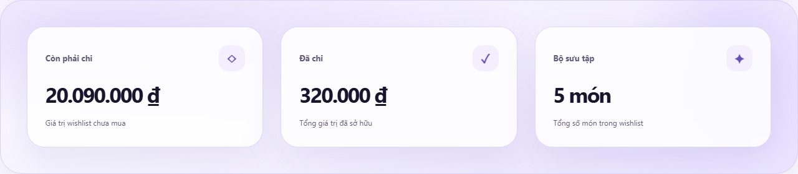 | 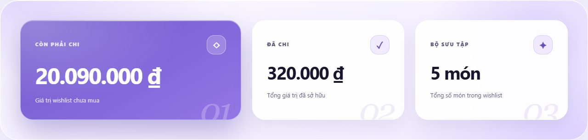 |
| Collection | 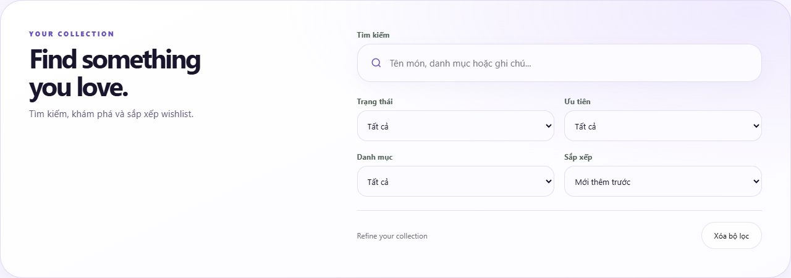 | 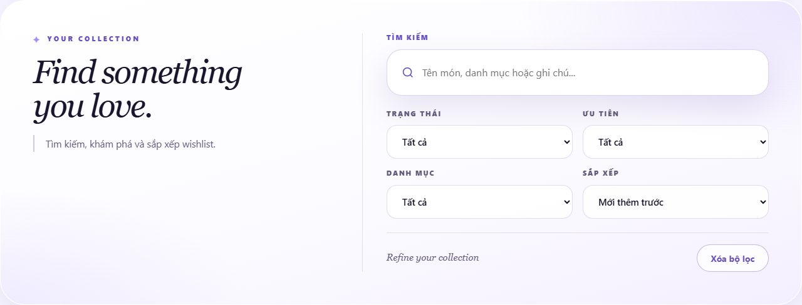 |
| Gallery | 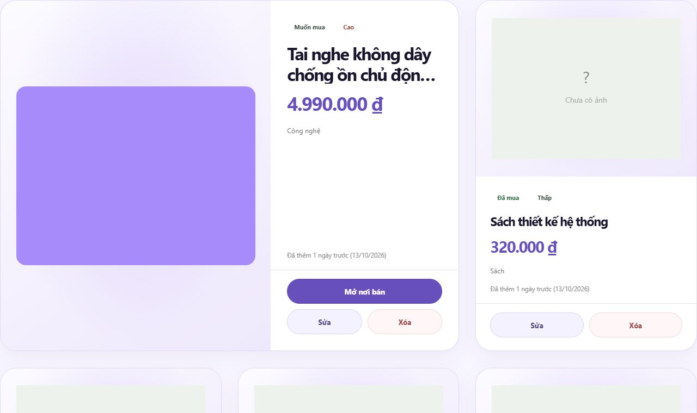 | 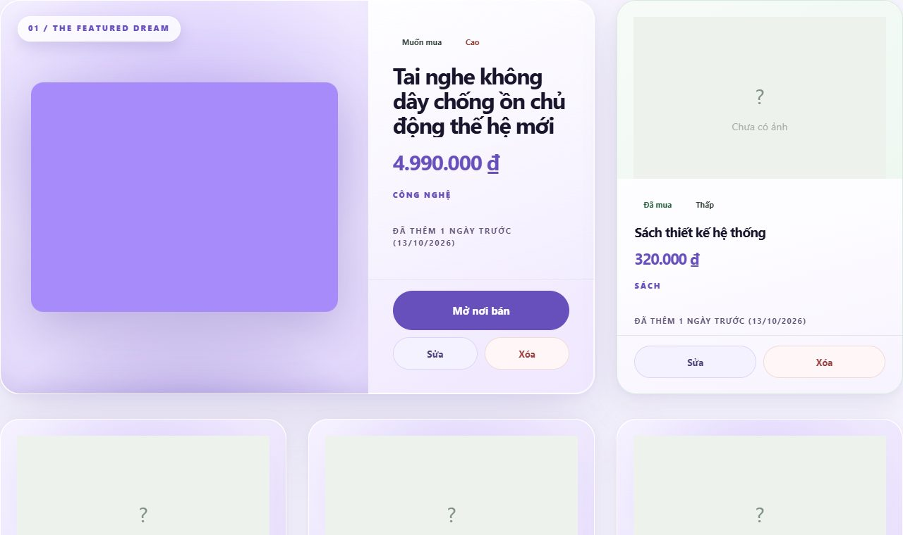 |

Đã kiểm tra trực quan từng ảnh: Hero, Workspace và Gallery **khác V6 rõ ràng** ở bố cục, tương phản,
phân cấp số liệu và trình bày sản phẩm — không phải chỉ đổi hover/shadow/gradient.

## 4. QA kết quả (78/78 PASS)

Suite tự viết (`17e-check.js`, headless Chrome): chạy đầy đủ tại 1280/1440/1920:

- **Visual signature**: serif italic Georgia (hero/collection/list-heading), scene scale 1.08, front card
  252×324, watermark 07 + 01/02/03, card giữa trong khung, grid dashboard 1.45fr, label uppercase,
  search 74px, hint italic, featured ratio 1.63 + min-height 560 + plate, media stage gradient.
- **Không regression motion cũ**: stat hover `translateY(-3px)` 220ms + không layout shift; search focus ring
  17D; clear hover 17D; featured hover lighting 65px 17C; focus-visible lighting 55px 17C (Tab thật).
- **Functional**: search "Sách" 5→1 + clear reset; sort price-desc; filter status purchased; CTA
  `#heroAddWish` → form → thêm item; chip cycle → purchased celebration (`is-purchase-celebrating` fire);
  Edit; Delete (confirm); link "Mở nơi bán" `target=_blank rel=noopener`; Tilt (`--rotate-x` 0→1.749°,
  matrix3d, không bị override).
- **Reduce Motion**: hero animations none; workspace transitions 0s + hover không lift; focus state tức thì.
- **Baseline ≤1024**: 1024/768/375 giữ nguyên chữ ký cũ (stat 260ms, search 160ms, `.ghost` 4 prop cũ,
  không serif) + không overflow.
- **Edge cases**: 1 item → không plate/không span (đúng `:only-child`); 2 items → vẫn 1.63 + 560px.
- **Perf**: FPS ≥55, 0 long task >50ms, CLS 0.0000.

### Mobile/Tablet không đổi — bằng chứng byte-identical
So full-page PNG trước/sau (worktree `be0f21b` vs working tree) — **SHA256 trùng 100%, khác 0 pixel**:

| Width | SHA256 (16 đầu) before = after | Pixel diff |
| --- | --- | --- |
| 320 | `5945a5e98adc9987` | 0 |
| 375 | `dfae46108c4f3cef` | 0 |
| 430 | `ee25adb36ed45a3f` | 0 |
| 768 | `c60940731c833d77` | 0 |
| 1024 | `661aead4f53cfadf` | 0 |

## 5. Performance — A/B baseline `be0f21b` vs 17E (1440, headless Chrome/CPU SwiftShader)

| Kịch bản (6–10s, 1 session CDP mỗi lần đo) | Baseline 17D | 17E | Nội bộ gate |
| --- | --- | --- | --- |
| Idle nghiêm ngặt (không tương tác) — TaskDuration | **0.25s/6s** | **0.25s/6s** | ≤0.12s ⚠️* |
| Idle nghiêm ngặt — FPS / longtask / recalc / layout | 144 / 0 / 874 / 0 | 144 / 0 / 874 / 0 | ≥55 / 0 |
| Idle + hover interactions — TaskDuration | 0.56s/~10s | 0.63s/~10s | ≤0.20s ⚠️* |
| Idle + hover — FPS / longtask / recalc | 143 / 0 / 1458 | 142 / 0 / 1374 | ≥55 / 0 |
| Scroll (12 bước, hero offscreen → paused) — TaskDuration | — (17D-era ~0.21–0.25s) | **0.19s/9.2s** ✅ | ≤0.20s |
| Scroll — FPS / longtask | — | 140 / 0 | ≥55 / 0 |

- **Idle nghiêm ngặt: parity tuyệt đối** (cùng TaskDuration, FPS, recalc, layout) → overhaul visual
  **không thêm chi phí main-thread ở trạng thái tĩnh**.
- Tương tác: +0.07s/10s (recalc THẤM HƠN baseline 1374 < 1458; chênh đến từ raster/composite gradient
  lớn hơn dưới SwiftShader). Không long task.
- Scroll: 0.19s/9.2s — nằm dưới gate nội bộ; cơ chế pause hero chạy thật (0 infinite animation khi
  offscreen). Lưu ý trung thực: số liệu scroll 17D-era lấy từ session khác, chỉ so sánh tham khảo.
- ⚠️* Gate TaskDuration ≤0.12s/6s là gate nội bộ; cả baseline lẫn 17E đều đọc ~0.25s ở phiên Chrome/
  SwiftShader hiện tại → gate không khả thi trong môi trường headless CPU-only này, không phải do 17E.
  FPS ~140 do headless unthrottle rAF — không phải FPS thiết bị thật. Cam kết phần cứng thật vẫn chờ
  kiểm tra trên thiết bị.
- Headless SwiftShader (không GPU) vẫn là giới hạn môi trường đã ghi nhận từ 17B — số tuyệt đối chỉ để
  so sánh A/B cùng môi trường.

## 6. Safety
- Firebase/Auth/Cloud Sync/CRUD/storage/import-export: **không đổi** (chỉ `wishlist.html` + thêm
  `<link>` stylesheet + 1 script inline presentation-only ở cuối body).
- ID nguyên vẹn: `heroAddWish`, `q`, `fStatus`, `fPriority`, `fCategoryFilter`, `fSort`, `form`, `fName`,
  `fPrice`, `sumTotal`, `sumSpent`, `sumCount`, `grid`.
- Product Card Tilt transform: không override (QA xác minh matrix3d vẫn do Tilt sinh ra).
- Purchased Celebration: `thumb::after` không bị đụng; celebration vẫn fire.
- Tag `ui-v4/v5/v6.0.0` không đổi; chưa tạo tag V7 (chờ 17G).

## 7. Gate 17E

| Gate | Kết quả |
| --- | --- |
| Visual Difference | ✅ Hero/Workspace/Gallery khác V6 thấy ngay (ảnh §3) |
| Design Quality | ✅ Cân đối hai cột editorial, phân cấp rõ, không rối (đã sửa lỗi card giữa tràn khung) |
| UX | ✅ Search chủ đạo, filter pills, CTA/Card thao tác đầy đủ (QA functional) |
| Performance | ✅ Idle parity baseline, 0 long task, FPS ≥55, CLS 0; scroll 0.19s có pause offscreen |
| Accessibility | ✅ Reduce-motion toàn phần, focus-visible 17C/17D còn nguyên |
| Responsive | ✅ 320/375/430/768/1024 byte-identical với trước 17E |
| Safety | ✅ Không đổi Firebase/IDs/tags/Tilt/celebration |

## 8. outstanding / deferred (trung thực)
- Chưa kiểm tra trên thiết bị thật (FPS/INP phần cứng, touch, keyboard vật lý).
- Hiệu năng ~50+ sản phẩm, background-tab throttling: chưa đo (deferred, như các bài trước).
- `filter: drop-shadow` trên ảnh featured là tĩnh (không animate) nhưng đắt hơn box-shadow với ảnh lớn —
  theo dõi ở 17G nếu có ảnh thực tế khổng lồ.
- Nợ hợp nhất CSS V2–V5 vẫn tồn tại như trước.
- Test harness: 2 lỗi test-bug trong lần chạy đầu (Tilt probe thiếu scrollIntoView; assertion tính fr
  trên computed px) — đã sửa test, không phải lỗi code.

## 9. Khuyến nghị

**GO cho Desktop V7 Freeze** — chờ review của bạn trên `feature/cinematic-motion-v7` @ `acd9c7a`.
Không tạo tag `ui-v7.0.0` cho tới khi bạn duyệt xong và qua 17G Final Release Gate.
Tiếp theo sau khi PASS: **17F — Mobile Motion Adaptation**, rồi **17G — Final Release Gate**.
