# Dream Vault V7 — 17F Mobile Premium Adaptation Review

**Ngày:** 2026-10-14 · **Branch:** `feature/cinematic-motion-v7`
**Trạng thái:** Source + QA hoàn tất — **91/91 PASS**, 0 console error
**Before:** `c8bf4c2` (17E Desktop Freeze, user PASS) · **After:** `69039bc` (mobile CSS + 1 dòng `<link>`)
**Môi trường:** Chrome/155.0.8059.40 headless (SwiftShader/CPU), server `127.0.0.1:8115`, dataset DS5 (5 món, gồm ảnh data-URI encode + link + ảnh hỏng fallback), localStorage `wishlist.items`
**Ngân sách:** $0 — không dependency mới, không icon font, không animation library
**Tag `ui-v7.0.0`:** CHƯA tạo — chờ 17G sau khi user nghiệm thu 17F

Deliverable duy nhất của 17F trong codebase:

- `css/cinematic-v7-mobile.css` (mới, 100% nằm trong `@media max-width: 1024px` / `max-width: 380px`)
- `wishlist.html:120` — thêm 1 dòng `<link>` **ngay sau** `cinematic-v7-visual-overhaul.css` (load layer 17F đè layer 17E chỉ ở mobile)
- Không đổi DOM/ID/JS/logic CRUD/Auth/Validation; không sửa V4/V5/V6; không sửa 17E (desktop đóng băng)

---

## 1. Art direction — Premium Editorial vers. mobile

Mobile (≤1024) nhận đúng DNA "Light Lavender × Premium Editorial" của desktop 17E, chia **3 tier**:

| Tier | Range | Cấp độ |
| --- | --- | --- |
| Compact phone | ≤380 (320, 350, 375) | Giãn dòng/gutter tiết kiệm (kicker 16em–rule 20px, description .88rem/gutter 10px, footer 9px) — đảm bảo 1 dòng, không đẩy CTA vào dock |
| Phone | 381–640 (430…) | Đầy đủ: rule 40px, description .93rem/gutter 14px, search 60px |
| Tablet | 641–1024 (768, 1024) | Hero 2-col + dashboard 1.45:1:1 + gallery 2-col (KHÔNG áp layout phone) |

Nguyên tắc đã tuân thủ: không animation loop trên mobile; không trang trí motion dưới `prefers-reduced-motion`; touch target ≥44px; KHÔNG override `transform` của Product Card Tilt (CSS mới không đụng `transform` trên `.wishlist-card`); bỏ `backdrop-filter` ở dock/panel/stat-card (dùng gradient tĩnh — tránh repaint khi scroll).

---

## 2. Thay đổi theo Workstream (đúng spec 17F A–E)

### A. Hero — Signature (giữ `heroAddWish`, CTA phụ, cấu trúc 3D, hotfix viewport ngắn)

- Kicker flex: `✦` thêm qua CSS `::before` (text "YOUR PERSONAL COLLECTION" giữ nguyên — dùng chung với desktop đóng băng) + hairline `::after`
- "Everything" + **Georgia italic** "you wish for." (signature line — `.hero__title span` block, Georgia italic từ mobile tier)
- Description: hairline 2px trái + gutter; CTA thành **pill 999px** (gradient #6E57CB→#5B45AD, min-height 52; secondary nền trắng/ink `--dream-ink #19152C`)
- Số đếm "**07**" dạng watermark Georgia italic sau nội dung (`::after`, `z-index:-1`, decorative)
- Stage: halo radial + vòng orbit nét đứt (`::before`/`::after` của `.hero__visual`) — KHÔNG loop; scene cards giữ inset layered shadows
- Footer "CURATED BY YOU. MADE FOR YOUR DREAMS." uppercase micro-label
- Hotfix viewport ngắn: giá trị V5 giữ nguyên tuyệt đối (mục 7)

### B. Dashboard — một stat card chủ đạo

- ≤760: stat 1 **span full hàng** với gradient violet #6E57CB + value trắng + icon; 2 card hỗ trợ nền sáng, nhỏ gọn, có **mã chương 01/02/03** watermark (Georgia italic)
- 761–1024: giữ hàng 3 cột tỷ lệ 1.45:1:1 (desktop DNA)
- `sumTotal` / `sumSpent` / `sumCount` không đổi (B4 PASS — "20.090.000 đ", "5 món")
- Tier ≤380: ẩn icon 2 card hỗ trợ + label 10px/.12em → nhãn "BỘ SƯU TẬP" luôn 1 dòng, value 2 card thẳng hàng (fix phát hiện khi review ảnh)
- Featured + purchased rules combine: card đã mua giữ look "owned" (viền #d5eadd) kể cả khi là first-child

### C. Collection — Search là tương tác chủ đạo

- Heading serif italic Georgia "Find something you love."; description hairline; eyebrow ✦
- Search: **60px**, radius 20, viền violet 1.5px, input **16px** (chặn zoom iOS), focus ring `:focus-within` được re-assert (không để selector `#q` của bản cũ đè mất)
- Đủ 4 filter (`fStatus/fPriority/fCategoryFilter/fSort`) + Clear + label uppercase micro + hint italic — keyboard/labels giữ nguyên (G1–G3 PASS)
- ≤380: padding search 14px → dùng được ở 320 (F1–F7 PASS @320)

### D. Gallery — triển lãm 1 cột

- ≤640: 1 cột; card đầu (`:first-child`) là **featured**: media cao hơn (1/0.92 vs 0.8), shadow sâu, plaque `01 / THE FEATURED DREAM` qua `.product-media::before` (`pointer-events:none`, không che control — D2 PASS)
- `object-fit: contain`; action pills (Mua ≥48px, Sửa/Xóa ≥44px); cat/meta uppercase editorial; badge trạng thái + màu owned giữ nguyên (D5)
- KHÔNG sửa Tilt/Celebration JS (G9/G10 PASS); ≥641: grid 2-col uniform giữ nguyên (F5 PASS)

### E. Motion & Dock

- 0 animation `infinite` dưới 1025px (H3 PASS — duyệt toàn bộ element)
- Feedback chạm ≤300ms, không loop (H4); `prefers-reduced-motion` tắt transition layer này mà UI vẫn dùng được (H5)
- Dock V5/V6 nguyên vẹn: hiện đủ 4 touch target ≥44px (F6), `#mobileAddWish` mở dialog, `#mobileSearchJump` focus `#q`, ẩn/hiện khi focus search **giống hệt baseline** (G7 A/B với bản gỡ 17F CSS) (F6/G5–G8 PASS)

---

## 3. Bằng chứng hình ảnh (before = `c8bf4c2`, after = `69039bc`, cùng DS5, JPEG q0.82)

### Full-page 4 size ưu tiên (320×700 / 375×667 / 375×812 / 430×932)

| Size | Before | After |
| --- | --- | --- |
| 320×700 | 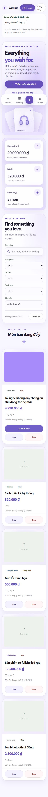 | 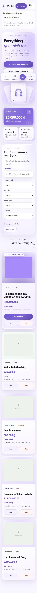 |
| 375×667 | 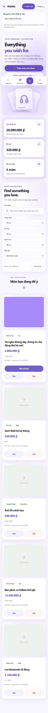 | 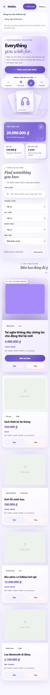 |
| 375×812 | 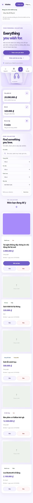 | 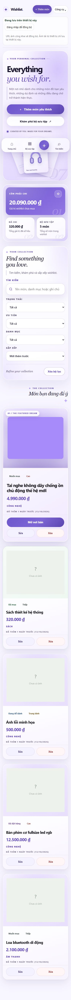 |
| 430×932 | 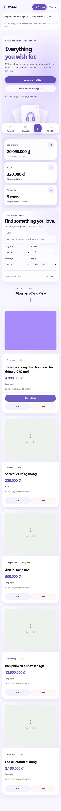 | 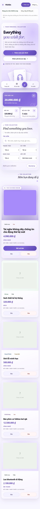 |

### Landing view cuộn 0 @hotfix zone (dock cố định đè lên hero — so sánh quan hệ CTA/dock)

| View | Before | After |
| --- | --- | --- |
| 375×667 | 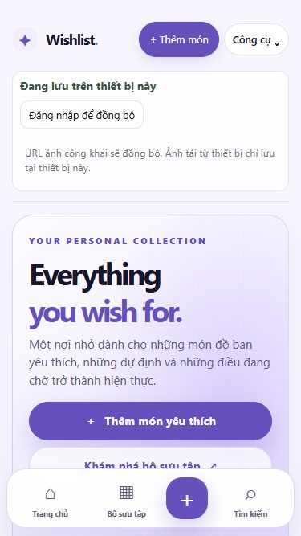 | 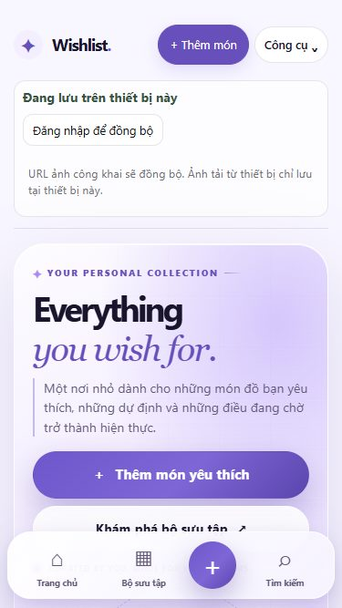 |
| 320×700 | 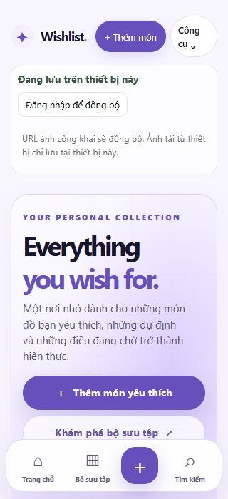 | 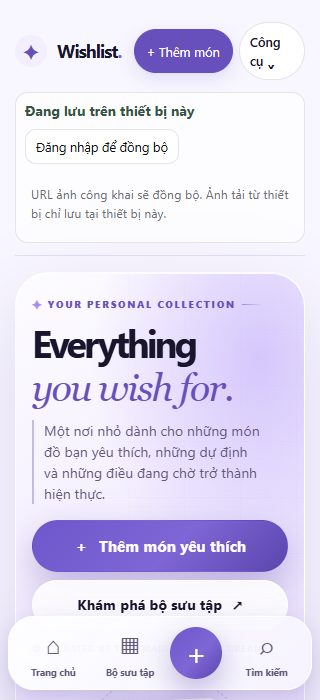 |

### Chi tiết từng khối @375×812

| Khối | Before | After |
| --- | --- | --- |
| Hero | 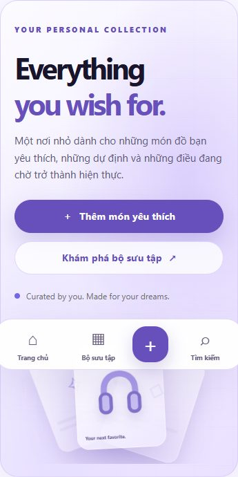 | 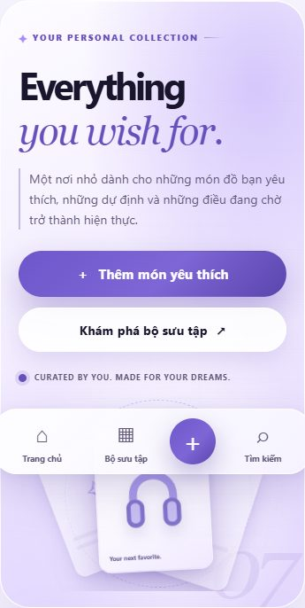 |
| Dashboard | 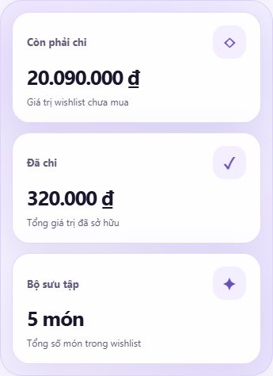 | 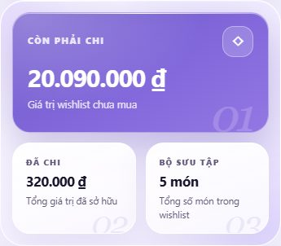 |
| Collection | 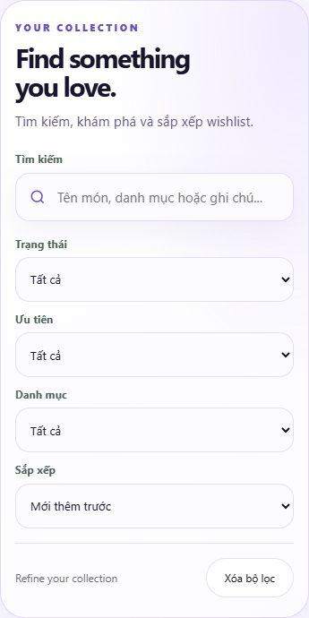 | 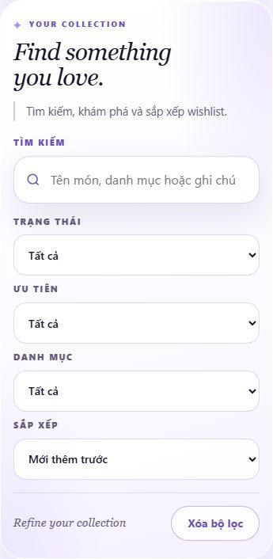 |
| Gallery | 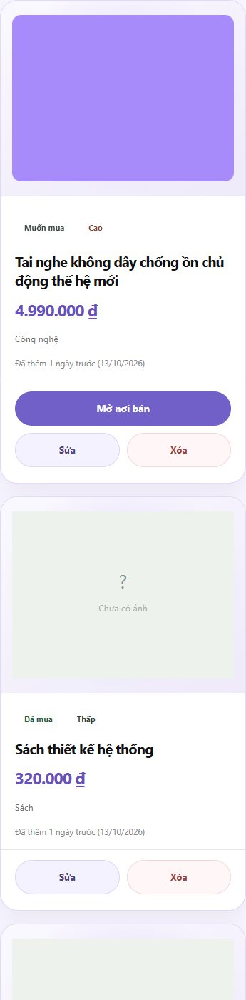 | 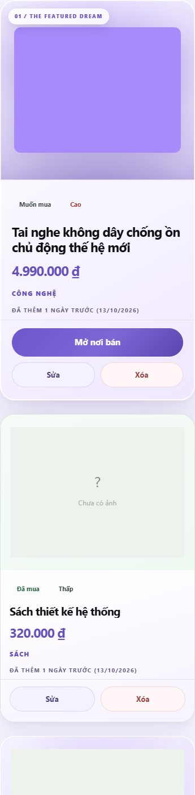 |

### Tablet regression (768 / 1024 — giữ hero 2-col, dashboard 1.45:1:1, gallery 2-col)

| Size | Before | After |
| --- | --- | --- |
| 768×1024 | 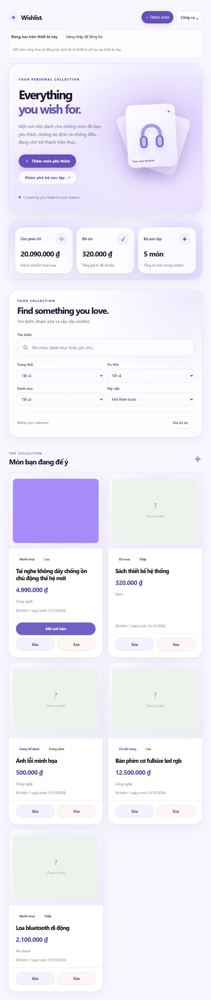 | 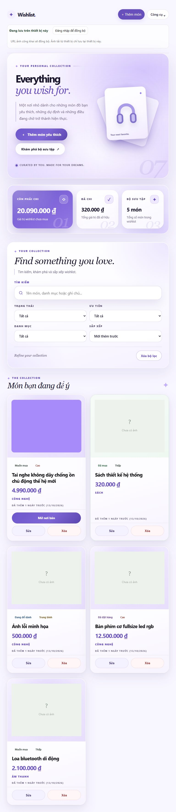 |
| 1024×768 | 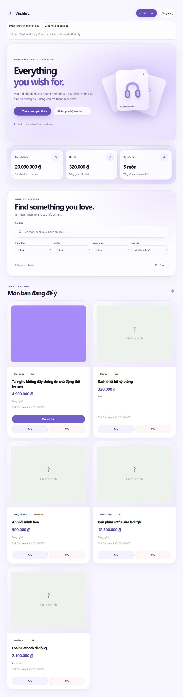 | 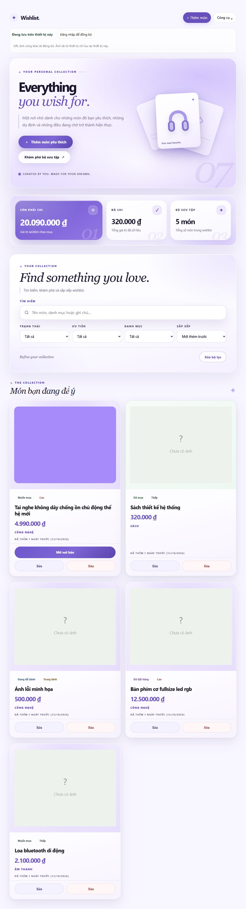 |

### Desktop ≥1025 — không đổi (byte-identical, xem mục 5)

| 1280×900 | Before | After (trùng byte) |
| --- | --- | --- |
| |  | 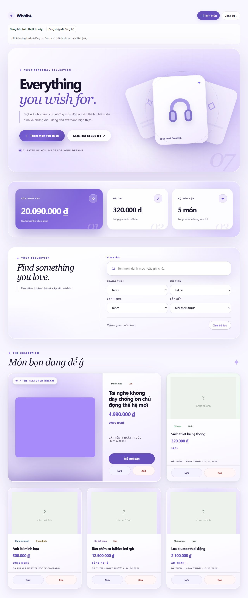 |

---

## 4. QA kết quả — **91/91 PASS, 0 console error** (`17f-check.js`, headless)

| Section | Số check | Nội dung | PASS |
| --- | --- | --- | --- |
| A — Style identity @375×812 | 24 | Hero (canvas nhiều lớp, ✦/rule, Georgia italic, hairline, pill, halo/orbit, scene shadow), Dashboard (gradient violet, white value, watermark 01/02/03, span full, `sumTotal/sumCount`), Collection (serif heading, search 60px/r20/16px, label uppercase, select ≥52, clear pill ≥44, hint italic), Gallery (1 cột, featured 0.92, plaque không che control, contain, pill ≥44, uppercase cat/meta, viền owned #d5eadd, shadow featured), console 0 lỗi | 24/24 |
| B — Structure @320/430/768/1024 | 32 | Không tràn ngang; kicker+footer 1 dòng; tier rule 20px (≤380) / 40px (>380); label stat 1 dòng; dashboard ≤760 span+2 cột / 761–1024 là 1.45:1:1; phone 1 cột / tablet 2 cột + hero 2-col; dock ẩn ở tablet, đủ 4 target ≥44px ở phone; console 0 lỗi | 32/32 |
| C — Functional @375 | 16 | Search 5→1 + clear; sort price-desc; filter purchased + clear; `heroAddWish` → dialog → thêm; `#mobileAddWish` → dialog; **Escape (trusted) đóng dialog**; dock focus A/B == baseline; `#mobileSearchJump` → `#q`; chip cycle → purchased + celebration; owned border sau thay đổi; sửa; xóa + confirm; buy link attrs; ảnh hỏng → placeholder; ảnh data-URI render 400px; console 0 lỗi | 16/16 |
| D — A11y/Motion | 5 | Tab tới `heroAddWish` có outline ≥2px; dock item focus-visible; **0 animation infinite**; transition ≤300ms; `prefers-reduced-motion` tắt transition + CTA vẫn dùng được | 5/5 |
| E — Hotfix viewport ngắn | 4 | 375×667 + 320×700: hotfix values giữ nguyên; primary CTA ≤ baseline | 4/4 |
| F — Desktop đóng băng | 7 | PNG byte-identical 1280/1440/1920; CSS scope 0 rule ngoài `@media`; không `min-width:1025`; A/B computed+search == baseline; console 0 lỗi (cả 2 build) | 7/7 |
| G — Edge cases | 3 | 1 item → không plaque (`:only-child`); dataset rỗng → empty state; 12 item → không tràn + plaque đúng card đầu | 3/3 |
| **Tổng** | **91** | | **91/91** |

Ảnh chụp trong mọi lượt: **0 console error** (cả 9 size).

---

## 5. Desktop ≥1025 — chứng minh KHÔNG ĐỔI (SHA256 full-page PNG, emulate `reduce` cho trùng lặp pixel)

| Width | Before (`c8bf4c2`) | After (`69039bc`) | Kết luận |
| --- | --- | --- | --- |
| 1280×900 | `90139b63a79f6c144e7cf1d7d091c27970830c634fe3344cbf12092749cd8271` | `90139b63a79f6c144e7cf1d7d091c27970830c634fe3344cbf12092749cd8271` | **IDENTICAL** |
| 1440×900 | `8748c34230db4a445e7aa68a0af1bb69f879fb4fd4e8a3d0d64eb1cb80cafb02` | `8748c34230db4a445e7aa68a0af1bb69f879fb4fd4e8a3d0d64eb1cb80cafb02` | **IDENTICAL** |
| 1920×1080 | `29b672aa510995c5de8665e50b36a0836e7c48bba83abfd37dd27508099f6715` | `29b672aa510995c5de8665e50b36a0836e7c48bba83abfd37dd27508099f6715` | **IDENTICAL** |

Hash mobile/tablet (tham chiếu — mobile ĐƯỢC phép đổi, đây là phần nâng cấp):

| Width | Before | After | |
| --- | --- | --- | --- |
| 320×700 | `7a02564b0ca49a6a` | `7aa9bcd128d4e0cd` | DIFF = upgrade |
| 375×667 | `2cd124b07dd56a2c` | `678c605a56fc89a0` | DIFF = upgrade |
| 375×812 | `1e933400cee36236` | `72997b747715e149` | DIFF = upgrade |
| 430×932 | `eb34e2443372188a` | `bbada351939f5d44` | DIFF = upgrade |
| 768×1024 | `b58b8adde5dda45f` | `a84df9f9af66d907` | DIFF = upgrade |
| 1024×768 | `3f212c86dd18aa4f` | `71c75e412731b7a8` | DIFF = upgrade |

Chứng minh phạm vi bằng static check: `cinematic-v7-mobile.css` **0 top-level rule** (toàn bộ nằm trong 7 khối `@media`), không chứa `min-width: 1025`; A/B runtime (gỡ `<link>` lúc chạy) cho computed style + search behavior desktop **giống hệt** baseline (J4 PASS).

---

## 6. Performance — A/B @375×812 (before = trạng thái đóng băng 17E, after = `69039bc`)

| Metric | Before ×2 run | After ×2 run | Ghi chú |
| --- | --- | --- | --- |
| Idle 6s TaskDuration | 0.07s / 0.07s | **0.05s / 0.05s** | tốt hơn |
| Scroll 10s TaskDuration | 0.23s / 0.23s | 0.26s / 0.25s | +0.02–0.03s/10s ≈ 0.25% wall time |
| Scroll RecalcStyle / Layout | 7 / 1 | 8 / 1 | +1 recalc |
| Scroll JS | 0.06s | 0.07s | không thêm JS (noise) |
| FPS (rAF, unthrottled) | 129 / 129 | 130 / 129 | đồng mức |
| Long tasks >50ms | 0 / 0 | **0 / 0** | PASS |
| CLS | 0.0000 | **0.0000** | PASS |

- Quyết định perf chủ đích: **bỏ `backdrop-filter`** ở dock/panel/stat-card (gradient tĩnh) để không tốn paint/scroll —17F không dùng bất kỳ backdrop-filter nào.
- Caveat trung thực: headless SwiftShader/CPU-only; FPS ~129 là rAF không throttle; **FPS/INP trên phần cứng thật: NOT VERIFIED**; chỉ đối chiếu A/B, không đặt gate tuyệt đối.

---

## 7. Short-viewport hotfix (375×667 & 320×700) — giữ nguyên + cải thiện

Computed values, before == after (I1 PASS, cả 2 size):

| Property | Giá trị (cả before/after) |
| --- | --- |
| `hero` padding-top | 24px |
| `hero` grid gap | 10px |
| eyebrow margin-bottom | 12px |
| description margin-top | 12px |
| description line-height | 1.5× (22.32px @baseline / 21.12px ≤380 do font .88rem — **tỷ lệ 1.5 giữ nguyên**) |
| actions margin-top / gap | 16px / 8px |
| footer margin-top | 12px |
| `.hero__visual` height | 220px (375) / 195px (320) |

Vị trí CTA vs dock (I2 PASS — đo trực tiếp, after so với baseline đã nghiệm thu):

| | 375×667 before | 375×667 after | 320×700 before | 320×700 after |
| --- | --- | --- | --- | --- |
| Primary CTA top | 500 | **495 (−5, cao hơn)** | 527 | **520 (−7, cao hơn)** |
| Secondary bottom | 604 | 605 | 631 | **630 (−1)** |
| Dock top | 583 | 583 | 616 | 616 |
| Chiều cao hero | 615 | **612** | 613 | **608** |

- Primary CTA luôn nằm trên đường dock ở scroll 0 ✓ và **cao hơn baseline** ở cả 2 size.
- Trung thực: secondary CTA **đã** nằm một phần sau dock ở scroll 0 trong baseline V5 (overlap 21px @375, 15px @320 — có sẵn từ trước 17F); after: 22px @375 (+1px do pill cao +2/+4px) và **14px @320 (cải thiện 1px)**. Đây là hành vi pre-existing của dock cố định V5, cuộn nhẹ là CTA ra khỏi dock — **không phải regression 17F**, giữ nguyên theo yêu cầu "giữ hotfix".
  > **UPDATE 17G:** đã được sửa dứt điểm bằng hotfix cuối (`@media (max-width: 640px) and (max-height: 740px)` — nén nhịp dọc hero, cả hai CTA thông thoáng hoàn toàn: clearance +19.3px @320, +11.8px @375, overlap = 0). Xem [Final Release Report 17G](final-release-report.md).

---

## 8. Safety checklist

- [x] $0 — không dependency, không font mới ngoài Georgia/system, icon ✦/gradient ASCII
- [x] Không sửa logic Firebase/Auth/CRUD/validation; không sửa JS; không đổi DOM/ID — chỉ +1 dòng `<link>`
- [x] Frozen tags `ui-v2.0.0`…`ui-v6.0.0` và CSS V4/V5/V6 không bị sửa; 17E desktop không sửa
- [x] Không override Tilt transform (CSS không đụng `transform` trên `.wishlist-card`); Tilt/JS không đổi (G9/G10)
- [x] 0 animation loop trên mobile (H3); reduced-motion functional (H5); touch ≥44px (F6)
- [x] Không force-push; chưa tạo `ui-v7.0.0`

---

## 9. Ghi chú test-harness (lỗi HARNESS, không phải lỗi app)

1. **Chrome 155 + data-URI:** Chrome 155.0.8059.40 từ chối data-URI chứa space thường (3/3 ERROR), percent-encode thì OK (3/3) — dataset 17F dùng `encodeURIComponent`. Ảnh 17E từng hiện raw URI là drift môi trường, **root cause NOT VERIFIED**; fallback `error → PLACEHOLDER` của app hoạt động đúng (G14 PASS).
2. **`img.loading="lazy"`** → full-page screenshot phải scroll-through trước (áp dụng giống hệt before/after).
3. **`getComputedStyle().border-*-width` trả giá trị integer đã snap:** declaration 1.5px đọc ra `"1px"` — kiểm chứng trên chính rule desktop 17E đóng băng cũng đọc `"1px"` → check dùng border color/style thay vì width (test artifact, không phải 1px thật).
4. **Dialog:** synthetic `KeyboardEvent` KHÔNG kích hoạt native `<dialog>` cancel → test Escape dùng trusted key (CDP); native `confirm()` chặn renderer → harness auto-accept (lần chạy đầu treo ở G12 là **test-harness bug**, đã fix; repro riêng delete chạy đúng).
5. **Suite self-found test bugs** (đều là lỗi test, 0 lỗi app): fixture tên cũ còn sót trong G12, thiếu dialog auto-accept, expected màu sai (`#2B1F5B` thay vì token thật `--dream-ink #19152C`), đọc border width.
6. Headless mặc định `prefers-reduced-motion: reduce` → ảnh "look thật" phải emulate `no-preference`; ảnh deterministic (hash desktop) dùng `reduce`.

**Sửa UI thật trong lúc review 17F** (đã đi vào commit `69039bc`, bắt bằng mắt/từ đo trước khi commit):
label "BỘ SƯU TẬP" wrap làm lệch value ở ≤380 (ẩn icon card hỗ trợ ở tier compact); kicker wrap 2 dòng ở 320 (compact tier ≤380); footer 2 dòng ở 320 (9px/.08em); hairline description đẩy CTA xuống 1 dòng ở 320 (font .88rem/gutter 10px ở ≤380 → primary top 520 < baseline 527); search 56→60px (đúng spec "dominant ≥60").

---

## 10. Outstanding / deferred (trung thực)

- **Touch/keyboard/scroll thật trên thiết bị thật, FPS/INP phần cứng: NOT VERIFIED** (headless SwiftShader).
- Background-tab throttling, 50+ sản phẩm: chưa test (chỉ stress 12 item — K3 PASS).
- Cost của `drop-shadow` trên card featured (desktop 17E + mobile 17F): theo dõi ở 17G.
- Nợ CSS V2–V5 chồng tầng vẫn còn (không thuộc 17F).
- Secondary CTA sau dock ở scroll 0 (mục 7) là hành vi V5 pre-existing — ghi nhận, không sửa để không phá hotfix đã nghiệm thu.
- Root cause lệch hành vi data-URI Chrome 155 vs môi trường 17E: NOT VERIFIED.

---

## 11. Gate 17F — khuyến nghị

**PASS khi user xem bộ ảnh mục 3** (cảnh quan mobile rõ ràng nâng cấp so với V6 mobile: editorial serif, kicker ✦, pill, stat card chủ đạo, triển lãm 1 cột có plaque) với các điều kiện đã chứng minh:

1. Desktop 1280/1440/1920 **byte-identical** (SHA256 mục 5)
2. **91/91 QA PASS**, 0 console error ở cả 9 size
3. Hotfix viewport ngắn **giữ nguyên + cải thiện** (mục 7)
4. $0, không đổi logic/DOM

Tiếp theo sau khi PASS: **17F đẩy lên `feature/cinematic-motion-v7`** (đã commit `69039bc` + commit docs) → user review → **17G — Final Release Gate** (tạo tag `ui-v7.0.0`).
